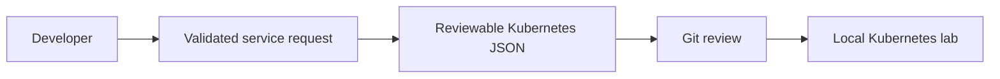

# Nordic Service Platform

[](https://github.com/HusnainWaleed/nordic-service-platform/actions/workflows/ci.yml)

A small deployment golden path for a fictional IT team moving from manual application setup to Kubernetes, connecting infrastructure support with developer self-service.

**Implemented:** input validation, digest-only image references, deployment bundle generation, a sample HTTP service, container recipe and automated tests. **Next:** GitOps reconciliation, build-and-scan pipeline and measured onboarding time. Kubernetes execution has not yet been validated in this environment.



## Try locally
Requires Python 3.12+. No cloud account is needed.
```sh
python -m unittest discover -s tests -v
python app.py
# In another terminal: curl http://localhost:8080/healthz
```

## Deployment workflow
Build and push the sample image to a registry you control. Record its real digest; the generator rejects mutable tags. The image below is illustrative and cannot be pulled.
```sh
python platform_cli.py workplace-status --owner lab-team --image ghcr.io/example/workplace-status@sha256:aaaaaaaaaaaaaaaaaaaaaaaaaaaaaaaaaaaaaaaaaaaaaaaaaaaaaaaaaaaaaaaa --output service.json
# Review service.json, substitute a real image digest, then use a disposable cluster:
kubectl apply --dry-run=server -f service.json
kubectl apply -f service.json
kubectl rollout status deployment/workplace-status --timeout=120s
kubectl port-forward service/workplace-status 8080:8080
```
Only run apply commands against a disposable lab context. Cleanup: `kubectl delete -f service.json`. For later releases, use `kubectl rollout undo deployment/workplace-status` only when a previous revision exists; verify health afterward.

## Boundaries and next experiment
The platform assumes HTTP on port 8080 and `/healthz`, one replica, and a non-root compatible image. It does not implement ingress, TLS, network isolation, secrets, tenancy or production availability. Review generated configuration before applying. Measure request-to-healthy-service time once the cluster workflow is exercised; no time-saving claim is made yet.

See [design decisions](docs/decisions.md) and [contribution/provenance notes](CONTRIBUTING.md).
